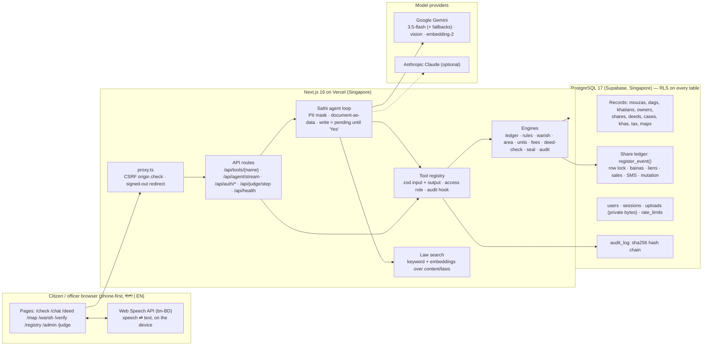
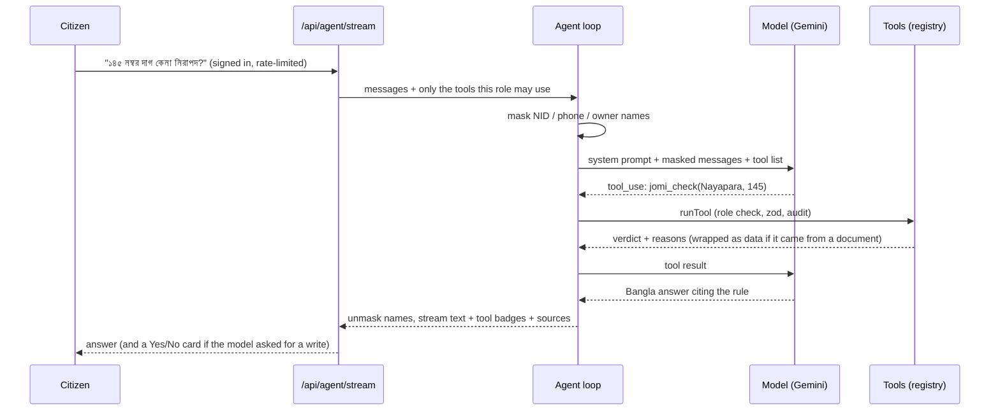
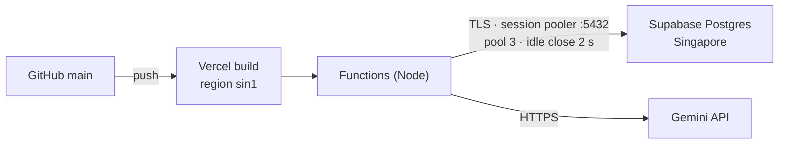

# BhumiSathi — architecture

One Next.js app, one Postgres database. The rule that keeps every feature consistent:

> **Every capability is one typed engine function (`lib/engines/*`), exposed once as a tool in
> `lib/tools/registry.ts`. Pages, the HTTP API and the AI agent all call the same tools.**
> The AI explains and orchestrates; engines compute; the database enforces.

## The big picture

## How a request flows

**A citizen checks a dag** (`/check?mouza=nay&by=dag&no=145`): the page calls
`runTool("jomi_check", …, {user})` → the registry checks the role, validates input with zod → the
engine loads the dag's facts (record chain, holders, bainas, liens, cases, khas, tax, map polygon)
→ `rules.ts` turns them into reasons and a red/amber/green verdict → output is validated again →
the view is appended to the hash-chained audit log → the page renders it.

**An officer registers a sale** (`/registry`): the desk runs `jomi_check` with the seller and area,
reads the numbers back, and only on “Yes” calls `register_sale` → `register_event()` in SQL locks
the dag row (`SELECT … FOR UPDATE`), recomputes the sellable share
(recorded − sold − active bainas − liens; khas, a pending case or a deceased holder block it),
accepts or refuses, bumps the ledger version, writes SMS and opens a mutation case — all in one
transaction. Two parallel sales: exactly one wins (tested).

**Sathi AI answers** (`/api/agent/stream`):

Write tools (`register_*`) are **never** executed by the loop: it stops and returns a pending action;
it runs only when the citizen presses Yes on the next request, and only if their role allows it.

**A sealed report** (`/check` → “সিলযুক্ত রিপোর্ট নিন”): `seal_issue` signs
`{mouza, dag, area, verdict, holders, ledger_version, time, key id}` with Ed25519, records the
issue (seal id + payload hash) in the audit log and returns a QR to `/verify#BS1.<payload>.<sig>`.
`/verify` checks: genuine (signature), current (ledger version unchanged), untouched (issue found in
an intact audit chain), shares add up.

## Data model (main tables)

| Group | Tables |
|---|---|
| Land records | `mouzas`, `dags` (+ `ledger_version`), `khatians` (CS/SA/RS/BS), `khatian_dags`, `owners`, `ownership_shares`, `deeds`, `court_cases`, `khas_flags`, `land_tax`, `map_polygons` |
| Share ledger | `bainas`, `liens`, `ledger_events`, `sms_log`, `mutation_cases`; views `bs_holdings`, `share_balances`, `share_sellable`, `dag_locks`; function `register_event()` |
| Identity | `users` (role, scrypt hash, lockout, linked holder), `sessions` (token hash), `uploads` (owner + bytes), `rate_limits` |
| Trust | `audit_log` (hash chain, `append_audit()`), `law_embeddings` |

Migrations: `supabase/migrations/0001` … `0006`, applied by `scripts/migrate.ts`. The synthetic
world is built deterministically by `scripts/seed-data.ts` (seed 2026).

## Engines (each one is plain TypeScript with unit tests)

| Engine | Does |
|---|---|
| `ledger.ts` | resolve a dag, sellable balance per holder, register baina/sale/lien via SQL |
| `rules.ts` | facts → reasons → verdict (TPA 1882 s.52, SAT 1950 s.143, LCPRA 2023 …) |
| `warish.ts` | exact-fraction faraid ('awl, radd, umariyyatayn, MFLO s.4) with Bangla + English working |
| `area.ts`, `map.ts`, `units.ts` | shoelace area at 16″ = 1 mile, calibrated photo measuring, regional units |
| `deed-check.ts` | deed fields vs records and map → findings; plain summary |
| `seal.ts`, `audit.ts` | Ed25519 seals; hash-chained audit log and its verifier |

## AI layer (`lib/ai`)

- `provider.ts` — Gemini (default), Anthropic, or Mock, chosen by `AI_PROVIDER`.
- `gemini.ts` — fallback chain (3.5-flash → 3.8-flash → 3.1-flash-lite), 45 s timeout, retries.
- `agent.ts` — the manual tool loop described above. `pii.ts` masks NID/phone/names.
  `documents.ts` wraps uploaded or retrieved text as data, never instructions.
- `rag.ts` — hybrid keyword + cosine search over `content/laws` and `content/qa.json`
  (Gemini embeddings cached in `law_embeddings`; keyword-only without a key).
- `vision.ts` — deed photo → JSON (schema from zod) → checked in code.

## Front end

- Shell: green government-portal look, original logo, sticky header, phone menu, footer, help button.
- Language: `components/i18n/LangProvider.tsx` — `useLang()`/`<T>`/`<Bi>`; choice in localStorage;
  each component reads the store itself so streamed parts hydrate without mismatch. Engines return
  Bangla and English text side by side.
- Accessibility: axe (WCAG 2.1 AA) clean on 18 pages at 375 px and desktop; visible focus;
  reduced-motion respected.

## Deployment

Postgres access goes through Supabase's **session** pooler: postgres.js sends several queries on one
connection at once, which the transaction pooler mixed up (found and fixed on the live site). The
pool is replaced after 10 s idle because serverless instances are frozen between requests.

## Testing

- **Unit** (pure engines, agent loop with a scripted model) and **integration** (real Postgres:
  ledger, RLS, audit tamper tests, G2/G3/G7) — `npm run check`.
- **E2E** — Playwright, one file per golden scenario, plus login/roles, accessibility, English mode,
  judge mode — at 375 px and desktop; `npm run e2e:live` runs the model-independent ones against
  the live site.
- **AI evaluation** — 20 held-out questions on the real model (`npm run eval:ai`, docs/AI_EVAL.md).
